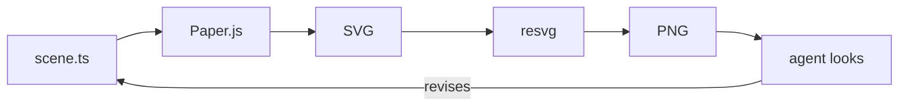
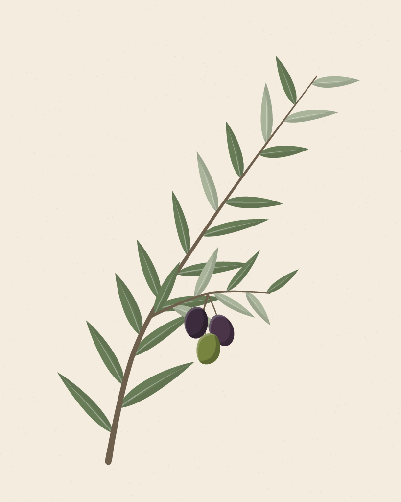
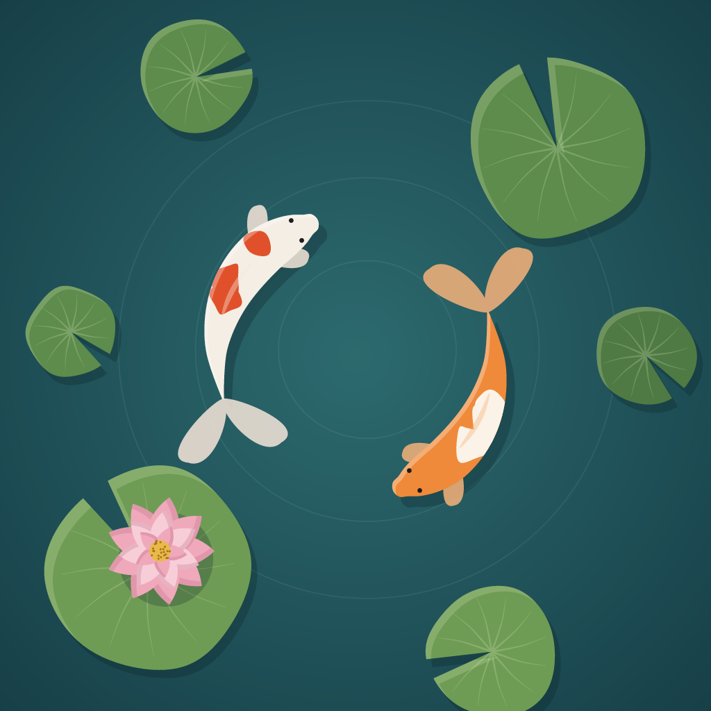

# dictadraw

* dictate an illustration in chat
* a coding agent writes it as TypeScript, renders it, looks at the result, and revises.
* the output is an editable SVG with named layers and groups.



Everything runs headless in Node: Paper.js draws the geometry (with jsdom, which it needs for SVG export), resvg rasterizes previews. `AGENTS.md` is the agent's workflow and drawing vocabulary.

## Examples

| Olive branch | Dusk meadow | Koi pond |
| --- | --- | --- |
|  |  |  |

| Cherry blossom with a 櫻 seal | Moonlight with a 芙蘭詩 name seal |
| --- | --- |
|  |  |

## Use

```sh
nix develop                                      # Node 26, pnpm 12, ImageMagick (or `direnv allow`)
pnpm install
pnpm art:render olive-branch                     # SVG + previews in output/olive-branch/
pnpm art:render olive-branch --crop 330,620,360,360   # also a zoomed detail
```

To start a new piece, ask the agent for it, for example: _"New artwork: a fox curled up asleep under falling maple leaves, warm autumn palette."_ It writes `artworks/<name>/brief.md` and `scene.ts`, renders, and iterates. Then give feedback the same way: _"Make the leaves smaller and scatter more of them on the left; keep the fox as is."_
