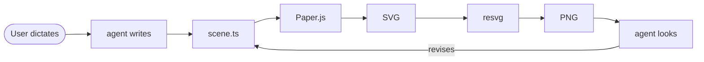
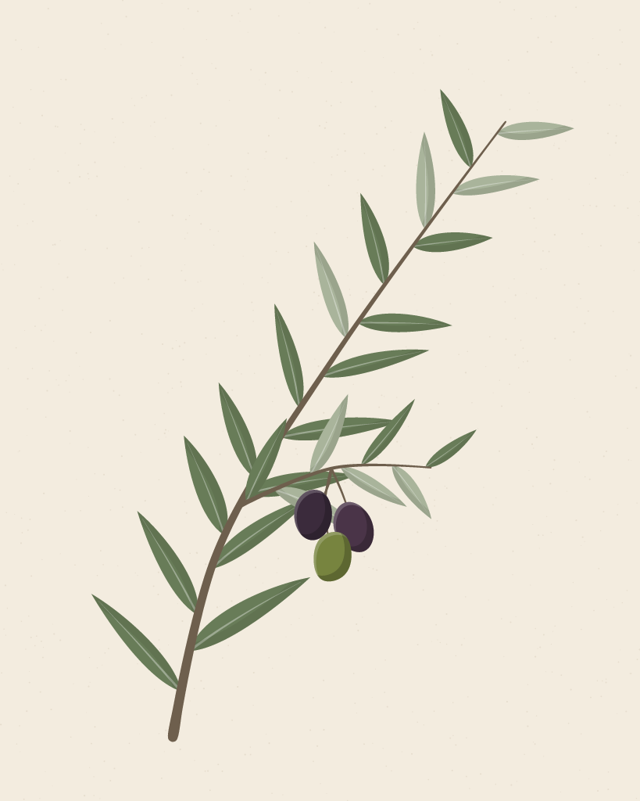
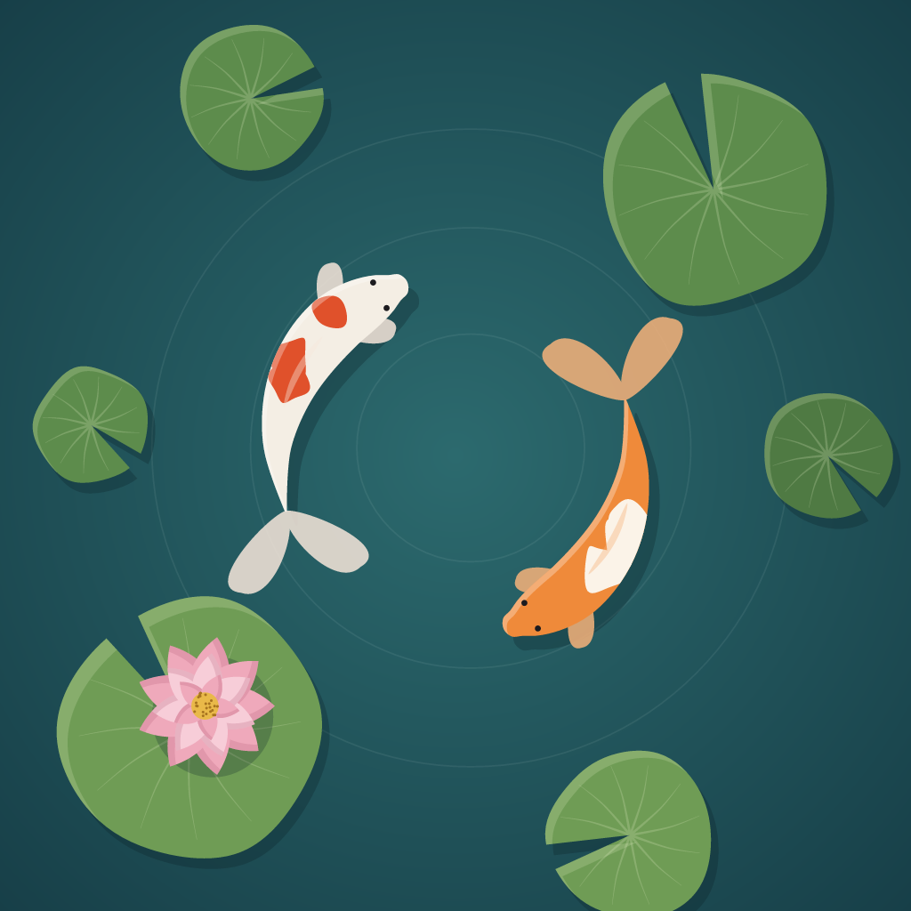

# dictadraw

* dictate an illustration in chat
* a coding agent writes it as TypeScript, renders it, looks at the result, and revises.
* the output is an editable SVG with named layers and groups.



Everything runs headless in Node: Paper.js draws the geometry (with jsdom, which it needs for SVG export), resvg rasterizes previews. `AGENTS.md` is the agent's workflow and drawing vocabulary.

## Examples

| Olive branch | Dusk meadow | Koi pond |
| --- | --- | --- |
|  |  |  |

| Cherry blossom with a 櫻 seal | Moonlight with a 芙蘭詩 name seal |
| --- | --- |
|  |  |

## Use

```sh
nix develop                                      # Node 26, pnpm 12, ImageMagick (or `direnv allow`)
pnpm install
pnpm art:render olive-branch                     # SVG + previews in output/olive-branch/
pnpm art:render olive-branch --crop 330,620,360,360   # also a zoomed detail
```

To start a new piece, ask the agent for it, for example: _"New artwork: a fox curled up asleep under falling maple leaves, warm autumn palette."_ It writes `artworks/<name>/brief.md` and `scene.ts`, renders, and iterates. Then give feedback the same way: _"Make the leaves smaller and scatter more of them on the left; keep the fox as is."_

## CI and dependency upgrades

| Workflow             | Trigger                    | Effect                                                                   |
| -------------------- | -------------------------- | ------------------------------------------------------------------------ |
| CI                   | Every PR and push to `main` | `nix flake check`, type-check, re-render every artwork against `output/` |
| Dependency Upgrades  | Mondays                    | npm PRs: within-major (`deps/upgrades`) and majors (`deps/npm-majors`)   |
| Toolchain Upgrades   | Wednesdays                 | `nix flake update` PR (`deps/toolchains`): Node 26, pnpm, CI tools       |
| Dependabot Auto-merge | Dependabot PRs            | Enables auto-merge on non-major updates                                  |

CI installs its tools from the flake's `ci` package, the same versions `nix develop` uses. Renders are deterministic, so CI fails when any committed file in `output/` would change: an upgrade that alters an approved artwork waits for you to re-render and commit on its branch.

| Source                                   | Auto-merges | Notes                                                        |
| ---------------------------------------- | ----------- | ------------------------------------------------------------ |
| `deps/upgrades` (npm within major)       | Yes         | Versions must be 3 days old; see `.github/scripts/ncurc.cjs` |
| `deps/toolchains` (flake inputs)         | Yes         | Moving to a new Node major is a manual edit in `flake.nix`   |
| Dependabot GitHub Actions and security   | Non-major   | Actions are grouped weekly on Thursdays with a 3-day cooldown |
| `deps/npm-majors`                        | No          | Opened even when the build breaks; fix on the branch, then merge |

Dependabot opens only security PRs for npm, since Dependency Upgrades owns routine bumps. A PR that fails CI stays open, and the next weekly run updates the same branch.

### One-time repository setup

Upgrade PRs are opened and merged with a GitHub App token, because PRs made with `GITHUB_TOKEN` trigger no workflows, so CI would never run on them.

1. Create a GitHub App owned by `cottongeeks` with webhooks off and repository permissions Contents, Pull requests, and Workflows set to read and write. Install it on this repository, and generate a private key.
2. Store its client ID and key as both Actions and Dependabot secrets. Workflows that Dependabot triggers can read only Dependabot secrets.

   ```sh
   for app in actions dependabot; do
     gh secret set DEPS_APP_CLIENT_ID -R cottongeeks/dictadraw --app "$app" --body "<client id>"
     gh secret set DEPS_APP_PRIVATE_KEY -R cottongeeks/dictadraw --app "$app" < path/to/private-key.pem
   done
   ```

3. Allow auto-merge and delete merged branches:

   ```sh
   gh repo edit cottongeeks/dictadraw --enable-auto-merge --delete-branch-on-merge
   ```

4. Once CI has run on `main`, require its `checks` job on `main`. Repository admins bypass the rule, so direct pushes still work. Without a required check, auto-merge would merge before CI finishes.

   ```sh
   gh api repos/cottongeeks/dictadraw/rulesets --method POST --input - <<'JSON'
   {
     "name": "require-ci",
     "target": "branch",
     "enforcement": "active",
     "conditions": { "ref_name": { "include": ["~DEFAULT_BRANCH"], "exclude": [] } },
     "bypass_actors": [{ "actor_id": 5, "actor_type": "RepositoryRole", "bypass_mode": "always" }],
     "rules": [{
       "type": "required_status_checks",
       "parameters": {
         "strict_required_status_checks_policy": false,
         "required_status_checks": [{ "context": "checks", "integration_id": 15368 }]
       }
     }]
   }
   JSON
   ```
